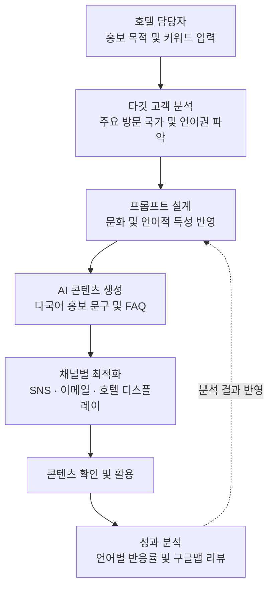

# AIGHT (에잇)

### We make AI right.
**AI로 마케팅의 새로운 정답을 만들다.**

---

<h2 style="border-bottom: none; padding-bottom: 0;">💡 About AIGHT</h2>

**AIGHT = AI + RIGHT**

AI와 RIGHT(정답, 올바른 방향)의 결합으로, AI 기술을 활용해 마케팅의 새로운 방향과 정답을 제시하는 팀입니다.

창의적인 아이디어와 전략적인 사고를 바탕으로 AI 마케팅의 새로운 가능성을 만들어갑니다.

---

<h2 style="border-bottom: none; padding-bottom: 0;">🏨 About Project</h2>

### 다국어 맞춤형 AI 마케팅 콘텐츠 자동 생성 시스템

외국인 관광객이 늘어날수록 호텔의 다국어 마케팅 업무도 많아집니다.

하지만 단순 번역만으로는 국가별 문화와 언어적 특성을 충분히 반영하기 어렵습니다. 다양한 홍보 채널에 맞는 콘텐츠를 매번 새롭게 작성하는 데에도 시간과 노력이 필요합니다.

**AIGHT는 호텔 담당자가 핵심 키워드만 입력하면 국가별 특성을 반영한 마케팅 콘텐츠를 생성할 수 있는 AI 시스템을 구축합니다.**

---

<h2 style="border-bottom: none; padding-bottom: 0;">✨ Key Features</h2>

| 기능 | 설명 |
|:---|:---|
| 🌍 타깃 고객 분석 | 주요 방문 국가와 언어권을 분석해 마케팅 대상 선정 |
| 🤖 AI 콘텐츠 생성 | 키워드를 바탕으로 다국어 홍보 문구, FAQ, 프로모션 안내문 생성 |
| 📝 프롬프트 라이브러리 | 국가별 문화와 언어적 특성을 반영한 프롬프트 템플릿 관리 |
| 📱 채널별 콘텐츠 최적화 | SNS, 이메일 뉴스레터, 호텔 디지털 디스플레이에 맞는 콘텐츠 구성 |
| 📊 성과 분석 | 언어권별 콘텐츠 반응률과 구글맵 리뷰 분석 |
| 📖 운영 매뉴얼 | 비개발자도 콘텐츠를 생성하고 관리할 수 있는 사용 가이드 제공 |

---

<h2 style="border-bottom: none; padding-bottom: 0;">🔄 Workflow</h2>

**키워드 입력부터 콘텐츠 생성, 성과 확인까지**

1. **키워드 입력**  
   호텔 담당자가 홍보 목적과 핵심 키워드 입력

2. **타깃 분석**  
   주요 방문 국가와 언어권, 고객 특성 파악

3. **프롬프트 설계**  
   국가별 문화와 언어적 특성, 현지 표현을 반영

4. **AI 콘텐츠 생성**  
   여러 언어의 홍보 문구, FAQ, 시즌별 프로모션 안내문 생성

5. **채널별 최적화**  
   SNS, 이메일 뉴스레터, 호텔 디지털 디스플레이 등 활용 목적에 맞게 구성

6. **성과 분석**  
   언어권별 콘텐츠 반응률과 구글맵 리뷰를 확인하고 향후 마케팅 방향에 반영

---

<h2 style="border-bottom: none; padding-bottom: 0;">🌐 Content Examplest</h2>

| 활용 분야 | 제작 콘텐츠 |
|:---|:---|
| SNS 홍보 | 국가별 특성을 반영한 홍보 문구 및 게시물 |
| 이메일 뉴스레터 | 호텔 소식, 시즌별 패키지, 이벤트 안내 |
| 호텔 디지털 디스플레이 | 다국어 홍보 문구 및 프로모션 안내 |
| 고객 FAQ | 호텔 이용 관련 자주 묻는 질문과 답변 |
| 프로모션 | 시즌별 숙박 패키지 및 이벤트 안내 |

---

<h2 style="border-bottom: none; padding-bottom: 0;">🛠️ Tools & Technologies</h2>

| 구분 | 활용 도구 | 활용 내용 |
|:---|:---|:---|
| 생성형 AI | ChatGPT | 다국어 홍보 문구, FAQ, 프로모션 안내문 생성 |
| AI 기술 | Prompt Engineering | 국가별 특성을 반영한 프롬프트 설계 |
| 디자인 | Figma | 시스템 화면 및 성과 대시보드 시안 제작 |
| 데이터 분석 | Excel | 글로벌 방문객 데이터 정리 및 타깃 분석 |
| 협업 | Notion | 프로젝트 일정, 회의록 및 기획 자료 관리 |
| 버전 관리 | GitHub | 프로젝트 파일 및 코드 관리 |

---

<h2 style="border-bottom: none; padding-bottom: 0;">🎯 Expected Outcomes</h2>

- **업무 효율 향상**  
  반복적인 번역과 홍보 문구 작성 업무 감소

- **다국어 마케팅 품질 향상**  
  국가별 문화와 언어적 특성을 반영한 콘텐츠 제작

- **마케팅 일관성 확보**  
  프롬프트 라이브러리를 활용한 콘텐츠 제작 기준 유지

- **데이터 기반 마케팅**  
  고객 반응과 리뷰 분석을 통한 콘텐츠 개선

- **지속적인 운영**  
  담당자가 변경되어도 활용할 수 있는 운영 매뉴얼 제공

---

  <b>“We make AI right” - AI로 마케팅의 새로운 정답을 만들다.</b>

